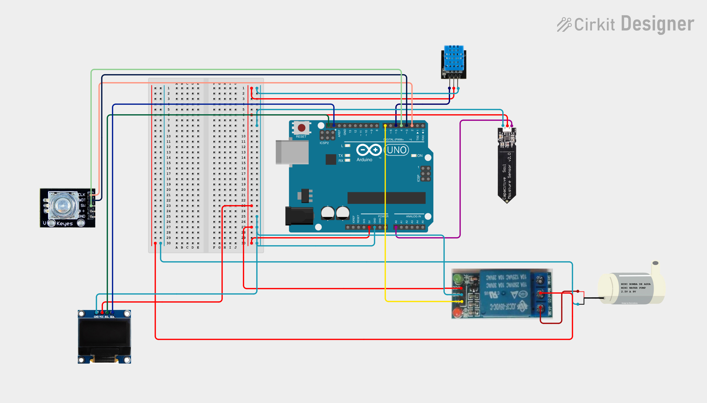

# SmartGarden 🌱
> **Sistema inteligente de control, monitoreo y riego automatizado para cultivos, jardines e invernaderos.**



---

## 📋 Descripción General

**SmartGarden** es una plataforma basada en microcontroladores (Arduino Uno / ATmega328P) orientada a la monitorización ambiental y la automatización del riego en plantas de interior, huertos y pequeños invernaderos. 

El sistema implementa un algoritmo de **riego pulsado inteligente** con pausas de absorción, lectura en tiempo real de humedad de sustrato y condiciones climáticas (temperatura y humedad relativa), interfaz gráfica animada en pantalla OLED, perfiles intercambiables de plantas persistidos en memoria EEPROM y mecanismos avanzados de seguridad para evitar desbordamientos o daños en la bomba.

---

## ✨ Características Principales

- **Dashboard Visual en Pantalla OLED (SSD1306 128x64 I2C):**
  - **Página 1 (Avatar Dinámico):** Gráficos animados adaptados al tipo de planta (Ficus Bonsái, Cactus/Suculenta o Helecho) con reacciones al clima en tiempo real (caritas sonrientes, carámbanos en heladas, gotas de sudor y sol brillante en calor extremo, y alertas de estado).
  - **Página 2 (Humedad del Suelo):** Medición en porcentaje (%) mapeada específicamente según la calibración de la planta activa.
  - **Página 3 (Métricas Ambientales):** Lectura de temperatura (°F/°C) y humedad relativa ambiental (%) mediante sensor DHT11.
  - **Página 4 (Lectura ADC Cruda):** Visualización directa del convertidor analógico-digital (0–1023) del sensor capacitivo para facilitar la calibración.
  - **Página 5 (Resumen del Perfil Activo):** Vista rápida de los umbrales de inicio/parada, duración del pulso y descanso.

- **Navegación Intuitiva con Encoder Rotativo (KY-040):**
  - Manejo por interrupciones de hardware (`attachInterrupt`) para una respuesta fluida e inmediata sin pérdidas de pasos.
  - Giro para rotar entre pantallas o ajustar valores, y pulsación para acceder al menú de configuración.

- **Perfiles Predefinidos y Editables por Tipo de Planta:**
  - Soporte para **Ficus**, **Suculenta** y **Helecho**.
  - Parámetros individuales: límite de sequedad (`dryLimit`), límite de humedad (`wetLimit`), duración del pulso de agua (`pulseTimeSec`) e intervalo de descanso (`intervalSec`).
  - Almacenamiento no volátil en **EEPROM** para conservar la configuración tras cortes de energía.

- **Estrategia de Riego Pulsado (Pulsed Watering):**
  - Aplica agua en pulsos breves (1–10 s) seguidos de pausas de reposo (5–60 s), garantizando que el sustrato absorba uniformemente el agua y evitando escurrimientos o saturaciones indebidas.

- **Mecanismos de Protección y Seguridad:**
  - **Corte por Tiempo Máximo (10 min):** Si un ciclo de riego supera los 10 minutos sin alcanzar el umbral de humedad, el sistema apaga la bomba y notifica una falla (`Status: Check H2O!`) para proteger el motor contra depósito vacío, mangueras obstruidas o sensores descolocados.
  - **Protección contra Bajas Temperaturas (<15 °C):** Pausa el bombeo si la temperatura ambiente es inferior a 15 °C, previniendo pudrición en raíces por absorción lenta en frío.
  - **Relé Seguro (Active-LOW):** Inicializado en estado apagado (`HIGH`) desde el arranque para evitar activaciones erráticas durante el inicio del microcontrolador.

---

## 🛠️ Hardware y Componentes

| Componente | Función / Descripción | Conexión / Pin |
|---|---|---|
| **Arduino Uno** (o compatible) | Microcontrolador principal (ATmega328P) | — |
| **Pantalla OLED 128x64 (SSD1306)** | Visualización de menús y gráficos I2C | `SDA` → `A4`, `SCL` → `A5` (Dir. `0x3C`) |
| **Sensor de Humedad Capacitivo** | Medición de humedad de suelo anticorrosión | Salida Analógica → `A0` |
| **Sensor DHT11** | Temperatura y humedad ambiental | Pin de datos → `D5` |
| **Encoder Rotativo (KY-040)** | Navegación e interacción con el menú | `CLK` → `D2` (INT0), `DT` → `D3`, `SW` → `D4` |
| **Módulo de Relé (1 canal)** | Conmutación de la bomba (Active-LOW) | Señal de control → `D7` |
| **Mini Bomba de Agua DC** | Impulsión del agua de riego | Alimentada mediante los contactos del relé |
| **Fuente de Alimentación Externa** | Suministro para la bomba (5V/12V según motor) | Tierra común (*GND*) con Arduino |
| **Diodo Flyback (1N4007 o similar)** | Supresión de picos inductivos del motor | En paralelo con los bornes del motor (cátodo a +) |

### ⚠️ Consideraciones Eléctricas de Instalación

1. **Alimentación Separada para la Bomba:** Las bombas de corriente continua generan picos de corriente que pueden reiniciar el Arduino o degradar la señal de los sensores si comparten la misma línea de alimentación. Conecte la bomba a una fuente independiente compartiendo únicamente la línea de tierra (*GND*).
2. **Diodo Flyback Obligatorio:** Instale un diodo rectificador en paralelo inverso a los terminales del motor de la bomba. Los motores DC con escobillas producen ruido electromagnético que congela el bus I2C de la pantalla OLED.
3. **Condensador de Desacoplo:** Se recomienda colocar un condensador electrolítico de 100 µF a 470 µF entre `5V` y `GND` cerca del módulo de relé y sensores para estabilizar el rizado de tensión.

---

## 📂 Estructura del Repositorio

```text
SmartGreenHouse/
├── README.md                      # Documentación general del proyecto (este archivo)
└── Smart-Plant/                   # Implementación del controlador Smart-Plant / Smart Ficus
    ├── 8699828e-ebff-438c-93bc-443a9cc8572e.png # Esquema visual del montaje
    ├── LICENSE                    # Licencia MIT del módulo
    ├── README.md                  # Especificaciones del módulo Smart-Plant
    └── Code/
        └── main.ino               # Código fuente Arduino (.ino)
```

---

## 🚀 Puesta en Marcha

### 1. Dependencias y Librerías

Instala las siguientes librerías desde el Gestor de Librerías de Arduino IDE (*Tools > Manage Libraries...*):

- `Adafruit SSD1306`
- `Adafruit GFX Library`
- `DHT sensor library` (Adafruit)
- `Wire` (incluida en el núcleo de Arduino)
- `EEPROM` (incluida en el núcleo de Arduino)

### 2. Calibración del Sensor de Humedad

Cada sensor capacitivo presenta tolerancias analógicas distintas:

1. Inicie el sistema y gire el encoder hasta la **Página 4 (Raw ADC Value)**.
2. Tome la lectura con el sensor completamente al aire y seco (típicamente ~570 ADC).
3. Sumerja el sensor en agua hasta la línea límite (sin mojar los componentes electrónicos) y anote el valor mínimo (típicamente ~220 ADC).
4. Acceda al menú de configuración (presionando el encoder) y ajuste los valores `Dry Limit` y `Wet Limit` de cada perfil dejando un margen de seguridad respecto a los valores extremos medidos.

### 3. Carga del Firmware

1. Abra `Smart-Plant/Code/main.ino` en el Arduino IDE.
2. Seleccione la placa `Arduino Uno` y el puerto serie correspondiente.
3. Compile y suba el programa al microcontrolador.

---

## 📊 Mapeo del Menú de Configuración

| Parámetro | Rango / Opciones | Descripción |
|---|---|---|
| **Profile** | `Ficus`, `Succulent`, `Fern` | Selección del perfil vegetal activo |
| **Dry Limit** | `wetLimit + 20` hasta `560` | Valor ADC para disparar el ciclo de riego |
| **Wet Limit** | `230` hasta `dryLimit - 20` | Valor ADC para detener el ciclo de riego |
| **Pulse Time** | `1` a `10` segundos | Duración de encendido continuo de la bomba |
| **Rest Pause** | `5` a `60` segundos | Tiempo de espera entre pulsos para drenaje |
| **Save & Exit** | — | Guarda los cambios en EEPROM y regresa al dashboard |

---

## 🔗 Referencias y Recursos

A continuación se recopilan los proyectos y guías de referencia utilizados para el diseño e inspiración de este sistema:

<details>
<summary><strong>Ver lista de proyectos en Arduino Project Hub</strong></summary>

- [Smart Plant por henrybruton](https://projecthub.arduino.cc/henrybruton/smart-plant-d32980)
- [ESP32 Mushroom Control System](https://projecthub.arduino.cc/lamtuanhung/esp32-mushroom-control-system-f97433)
- [IoT Smart Greenhouse Monitoring and Automatic Control System](https://projecthub.arduino.cc/khoanguyen345/iot-smart-greenhouse-monitoring-and-automatic-control-system-721735)
- [DIY IoT Plant Watering System Using Arduino](https://projecthub.arduino.cc/me_yogesh/diy-iot-plant-watering-system-using-arduino-b00eb3)
- [Urban Agriculture: Development of a Smart Edge AI Garden](https://projecthub.arduino.cc/hugo_andreu_sobrino/urban-agriculture-development-of-a-smart-edge-ai-garden-59f2e4)
- [Lazy Indoor Garden](https://projecthub.arduino.cc/londonium2021/lazy-indoor-garden-c1d373)
- [Self-Sufficient Watering IoT Station for Vertical Garden](https://projecthub.arduino.cc/mattiamangia2/self-sufficient-watering-iot-station-for-vertical-garden-ff0fc4)
- [Automatic Watering System](https://projecthub.arduino.cc/PRosenb/automatic-watering-system-439148)
- [Garden Habitat Data Pipeline: Sensors, Java, Docker, Python](https://projecthub.arduino.cc/embeddedgarden/garden-habitat-data-pipeline-sensors-java-docker-python-d2892c)
- [DIY Mushroom Smart Farm](https://projecthub.arduino.cc/hchoi22/diy-mushroom-smart-farm-5f8323)
- [Remote Controlled Garden Watering Device](https://projecthub.arduino.cc/NassauLv/remote-controlled-garden-watering-device-cdcdab)
- [Garduino](https://projecthub.arduino.cc/biswa11/garduino-ef31a5)
- [Smart Garden IoT System](https://projecthub.arduino.cc/vipulbhardwaj785/smart-garden-iot-system-84fe13)
- [Automatic Watering System](https://projecthub.arduino.cc/NatchaphonTah/automatic-watering-system-659dad)
- [Automated Urban Garden Controller](https://projecthub.arduino.cc/areifsnyder/automated-urban-garden-controller-12ecc6)
- [Garduino Project](https://projecthub.arduino.cc/Ameduino/garduino-950b7c)
- [IoT Weather Station](https://projecthub.arduino.cc/enriquekirkpatrickc/iot-weather-station-d6033a)

</details>

<details>
<summary><strong>Ver lista de proyectos y tutoriales en Instructables</strong></summary>

- [Arduino for Greenhouse, Garden or Growbox](https://www.instructables.com/Arduino-for-Greenhouse-Garden-or-Growbox)
- [Watering Garden with GARD-A-WATER Arduino Project](https://www.instructables.com/Watering-Garden-with-GARD-A-WATER-Arduino-Project)
- [Automatic Garden Watering Device Arduino](https://www.instructables.com/Automatic-Garden-Watering-Device-Arduino)
- [Arduino Auto Watering Garden Project](https://www.instructables.com/Arduino-Auto-Watering-Garden-Project)
- [CoreConduit Automated Garden Controller System](https://www.instructables.com/CoreConduit-Automated-Garden-Controller-System)
- [Simple Scalable Raspberry Pi Garden Irrigation](https://www.instructables.com/Simple-scalable-Raspberry-pi-garden-irrogation)
- [Remote Solar Garden Watering System](https://www.instructables.com/Remote-Solar-Garden-Watering-System)
- [An Arduino Hydroponics and You: A Solar-Powered Micro Garden](https://www.instructables.com/An-Arduino-Hydroponics-and-You-A-Solar-Powered-Mic)
- [Smart Garden 1](https://www.instructables.com/Smart-Garden-1)
- [Automated Garden Watering Using Arduino](https://www.instructables.com/Automated-Garden-Watering-Using-Arduino)
- [GrOwn: A Solar Powered Arduino Garden](https://www.instructables.com/GrOwn-a-Solar-Powered-Arduino-Garden)
- [Domotic Garden 2016](https://www.instructables.com/Domotic-Garden-2016)
- [Automated Garden](https://www.instructables.com/Automated-Garden)
- [Monitor Your Garden](https://www.instructables.com/MONITOR-YOUR-GARDEN)
- [DIY Automated Garden Irrigation Arduino IoT](https://www.instructables.com/DIY-Automated-Garden-Irrigation-Arduino-IOT)
- [IDC2018 IoT Smart Garden Click and Grow](https://www.instructables.com/IDC2018IOT-Smart-Garden-Click-and-Grow)
- [Automated Ground Water Garden Irrigation](https://www.instructables.com/Automated-Ground-Water-Garden-Irrigation)
- [Raspberry Pi Powered IoT Garden](https://www.instructables.com/Raspberry-Pi-Powered-IOT-Garden)
- [Plant Cubed: A Fully Automated Garden Box](https://www.instructables.com/Plant-Cubed-a-Fully-Automated-Garden-Box)
- [Smart IoT Garden](https://www.instructables.com/Smart-IoT-Garden)
- [IoT Garden Watering With Arduino ESP32 Openweather](https://www.instructables.com/IoT-Garden-Watering-With-Arduino-ESP32-Openweather)
- [Connected Automatic Garden Watering System](https://www.instructables.com/Connected-Automatic-Garden-Watering-System)
- [Automated Garden System Built on Raspberry Pi](https://www.instructables.com/Automated-Garden-System-Built-on-RaspberryPi-for-O)
- [Automatic Garden Watering System by Arduino LCD Button](https://www.instructables.com/Automatic-Garden-Watering-System-BY-Arduino-LCD-Bu)
- [3D Printed Arduino Controlled Hydroponic Garden](https://www.instructables.com/3D-Printed-Arduino-Controlled-Hydroponic-Garden)
- [Automatic Garden Watering System](https://www.instructables.com/Automatic-Garden-Watering-System)
- [Off-Grid Solar and Hand-Crank Smart Watering System](https://www.instructables.com/Off-Grid-Solar-and-Hand-Crank-Smart-Watering-Syste)

</details>

---

## 📄 Licencia

El módulo `Smart-Plant` se distribuye bajo la licencia **MIT**. Para más detalles, consulte el archivo [Smart-Plant/LICENSE](./Smart-Plant/LICENSE).
